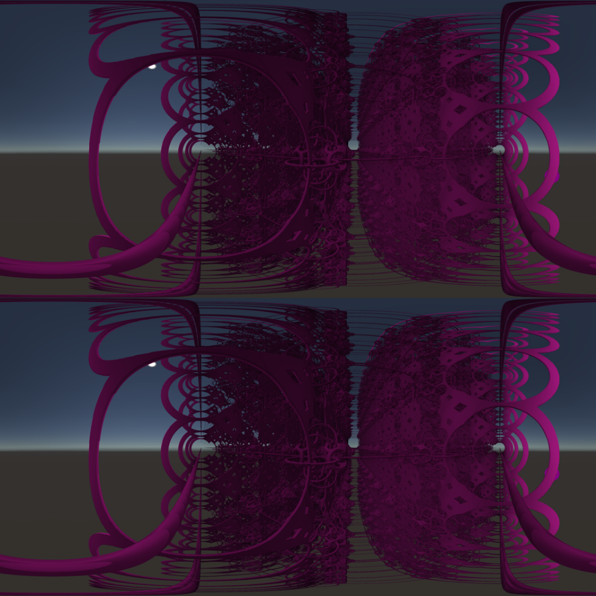

# RMFractal. Fractal Generator for VR

A Unity application for generating 3D fractal scenes of user-selected classes (interiors, architecture, landscapes, flora, cities) and rendering them as stereo 360° VR video.

RMFractal is the application from a team B.S. thesis at HSE University (Moscow, 2021), *Development of Methods and Algorithms for Fractal Modeling for Dynamic 3D VR Systems*. Each fractal class is a separate scene with its own parameter panel, reached from a main menu.

<p>
  
  
</p>

*Left: "Interior" class, raymarched "Lamp" object. Right: "Landscape" class, Diamond-Square terrain. The UI is in Russian.*

---

## Fractal Classes

| Class | Scene | Method | Rendering |
|---|---|---|---|
| Interior | `Interier.unity` | IFS (SDF fractals) | Raymarching |
| Architecture | `House.unity` | IFS (Menger-based SDFs) | Raymarching |
| Landscape | `Landscape.unity` | Diamond-Square | Rasterization (mesh) |
| City | `Town.unity` | L-system (2D) | Rasterization (prefabs) |
| Flora | `Tree.unity` | L-system (3D) | Rasterization |

<p>
  
  
</p>

*Left: "Architecture" class, raymarched "High-rise" subclass. Right: "City" class, L-system road layouts with buildings.*

<p>
  
  
</p>

*"Flora" class: the same L-system tree generator producing a tree (left) and a bush (right) with different parameters.*

Raymarching was used for the mathematically complex classes because it evaluates the fractal per pixel, without building geometry, and allows infinite repetition at almost no extra cost. Rasterization was kept for mesh-based classes, where textures and physics are easier to apply.

---

## Team

| Member | Responsibilities |
|---|---|
| **Tatiana Chibisova** | Raymarching renderer for Unity, SDF fractal library, Diamond-Square terrain, "Interior" and "Landscape" classes, application UI, integration of all class generators, VR renders of her classes |
| Valentina Rogova | L-system in 2D, "Architecture" and "City" classes, stereo 360° render script, ECG module, VR renders of her classes |
| Alfiya Zaripova | L-system in 3D, "Flora" and "Fauna" classes, VR renders of her classes, VR viewing experiments and render guidelines |

All three members took part in the VR perception experiments.

---

## Features

### Application

- **Main menu** with class selection and display settings (fullscreen, resolution, quality)
- **Per-class parameter panels** that update the scene live
- **Fly-through mode:** pilot a player ship through the raymarched fractal, with collision against the fractal surface through a spherical force field

### Raymarching Renderer

- Full-screen image-effect raymarcher (`OnRenderImage`) that rebuilds per-pixel rays from the camera frustum corners
- Adaptive step size near surfaces to limit overstepping
- Surface normals from the SDF gradient (central differences)
- Lambertian lighting, soft shadows, step-count ambient occlusion, and distance fog
- Two-color gradient driven by fractal iteration depth
- Live editing in the Scene view (`ExecuteInEditMode` + `SceneViewFilter`)

### SDF Fractal Library

- **Primitives:** sphere, box, rounded box, cylinder, triangular prism, tetrahedron, pyramid, octahedron, plane
- **Operators:** union, subtraction, intersection, smooth variants, and domain repetition (infinite tiling at negligible cost)
- **Fractals:** Menger sponge (cube, cylinder and pyramid variants), negative sphere, Sierpinski, Mandelbulb, Tower IFS, Pseudo-Kleinian, lampshade pattern, and an SDF terrain

The "Interior" panel (`FractalCreator.cs`) exposes fractal type, iterations, scale factor, per-iteration offset and rotation, global position, rotation and scale, domain repetition, a section plane, symmetry, and color.

### Other Generators

- **Diamond-Square terrain:** heightmap mesh with adjustable polygon count, area and height
- **L-system city:** randomized road networks with intersections and dead ends, with buildings and trees placed along the roads (based on a Sunny Valley Studio tutorial, see [Credits](#credits))
- **L-system trees:** 2D and 3D branching; parameters produce trees, shrubs and grass-like shapes
- **Stereo 360° capture:** left/right-eye cubemaps converted to equirectangular frames for VR video



*Stereo 360° frame (top/bottom eyes) of an "Interior" scene.*

---

## Thesis Results

### Render Performance

A test sphere was rendered with each visualization method in the 360° formats (thesis Table 7):

| Method | Render time, 360 (built-in) | Render time, stereo 360 (built-in) | FPS, 360 |
|---|---|---|---|
| Raymarching | 9.75 | 14.13 | 31 |
| Rasterization | 11.21 | 16.69 | 27 |
| Ray tracing | 15.47 | 23.93 | 19 |

Raymarching rendered fastest, which is why it was chosen for the mathematically complex classes.

### VR Viewing Study (Pilot)

Participants watched calm, extreme, and fractal VR videos while heart rate (ECG, Arduino Nano + AD8232) and galvanic skin response (KARDI-2np) were recorded. The study was a small pilot with 3 participants, so these are recommendations, not general findings:

- Frame rate of **60–90 fps**; 50 fps caused motion sickness
- Stereo separation of **0.3–0.5** instead of Unity's default of 0.064 for comfortable stereo 360° video
- Smooth camera animation without abrupt transitions; fractal class had little effect compared with animation quality

---

## Getting Started

**Requirements:** Unity **2020.3.0f1**, Built-in Render Pipeline.

1. Clone the repository and open it in Unity Hub.
2. Open `Assets/Scenes/MainMenu.unity` and press Play.
3. Choose a class from the menu, adjust its parameters, and use fly-through mode to explore raymarched scenes.

To open a class directly, load its scene from `Assets/Scenes/Classes/`.

---

## Project Structure

```
Assets/
├── Scenes/
│   ├── MainMenu.unity           # entry point
│   ├── Menu/                    # menu navigation and scene loading
│   └── Classes/                 # one scene per fractal class
├── Raymarching/scripts/         # Interior: fractal creator UI, raymarch camera, player and collision
├── Shaders/                     # Interior: raymarching shader, distance functions, force field
├── Architecture/Script/         # Architecture: raymarch camera, shader, distance functions
├── Landscape/Scripts/           # Diamond-Square terrain mesh generation
├── Town/                        # L-system city: generator, road and structure placement, models
├── Tree/                        # recursive tree generation
├── Prefabs/                     # player, scene setup
└── Fonts/
```

---

## Known Limitations

- Scene saving and loading is not implemented in this repository; `SaveLoad.cs` and `SaveData.cs` are empty stubs.
- Build Settings contain outdated scene paths; add the scenes from `Assets/Scenes/` before building.
- `OnRenderImage`-based raymarching requires the Built-in Render Pipeline (not URP/HDRP).
- Fractal iteration counts are limited by GPU power; high values drop the frame rate quickly.

---

## Credits

- **City generation:** the L-system town scripts in `Assets/Town/Scripts/` (namespace `SVS`) are adapted from Sunny Valley Studio's procedural town tutorial ([svstudio.itch.io](https://svstudio.itch.io)).

---

## Thesis

Chibisova T., Rogova V., Zaripova A. *Development of Methods and Algorithms for Fractal Modeling for Dynamic 3D VR Systems.* B.S. thesis, Computer Engineering, HSE University, Moscow, 2021.
