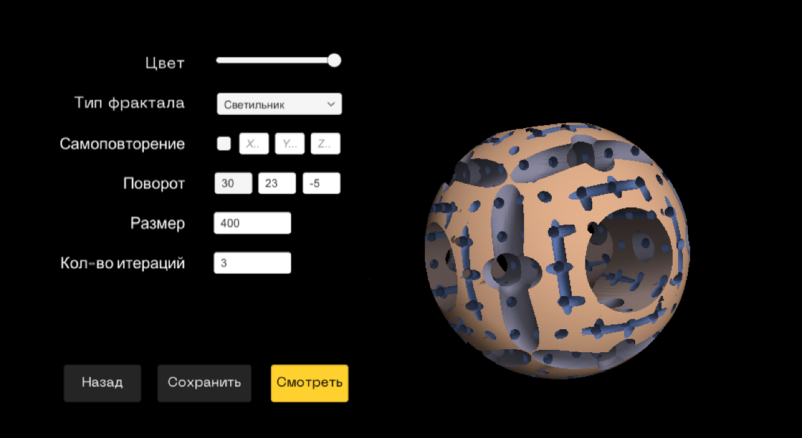
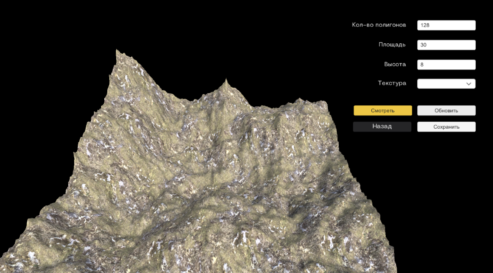
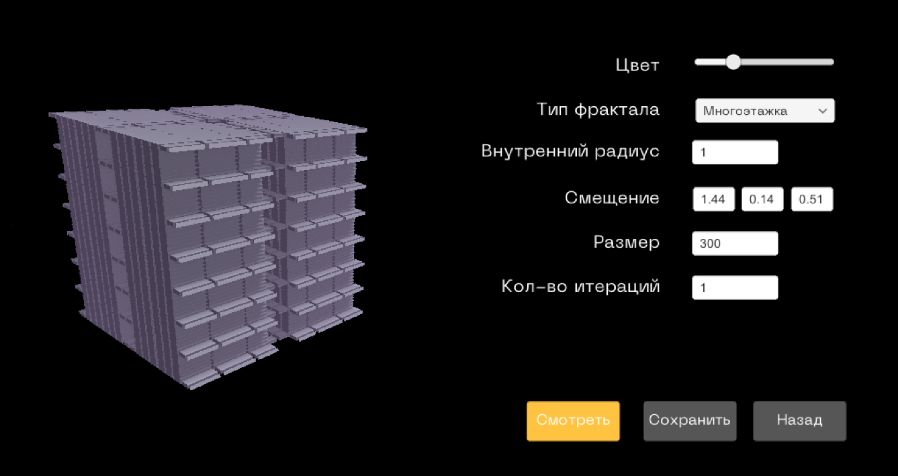
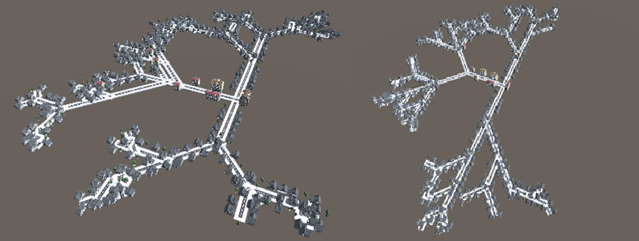
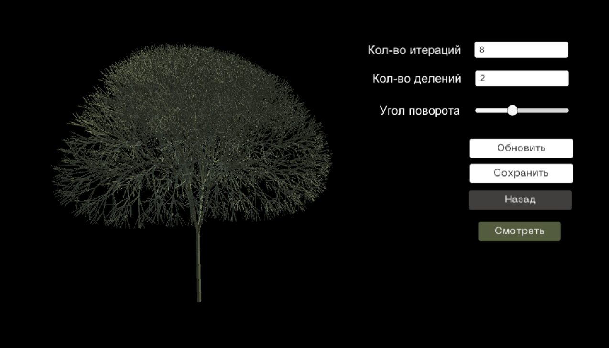
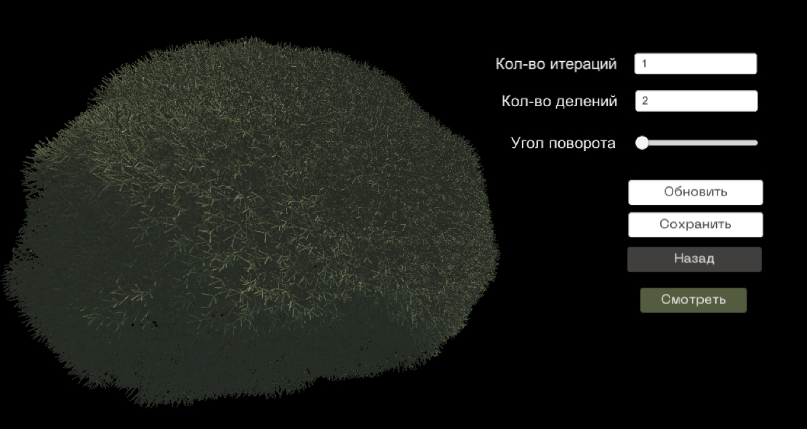

# RMFractal — Fractal Generator for VR

A Unity application for generating 3D fractal scenes of user-selected classes (interiors, architecture, landscapes, flora, cities) and rendering them as stereo 360° VR video.

RMFractal is the integrated application from a team B.S. thesis at HSE University (Moscow, 2021), *Development of Methods and Algorithms for Fractal Modeling for Dynamic 3D VR Systems*. Each fractal class is a separate scene with its own parameter panel, reached from a main menu.

<p>
  
  
</p>

*Left: "Interior" class, raymarched "Lamp" object. Right: "Landscape" class, Diamond-Square terrain. The UI is in Russian.*

---

## Fractal Classes

| Class | Scene | Method | Rendering |
|---|---|---|---|
| Interior | `Interier.unity` | IFS (SDF fractals) | Raymarching |
| Architecture | `House.unity` | IFS (Menger-based SDFs) | Raymarching |
| Landscape | `Landscape.unity` | Diamond-Square | Rasterization (mesh) |
| City | `Town.unity` | L-system (2D) | Rasterization (prefabs) |
| Flora | `Tree.unity` | L-system (3D) | Rasterization |

<p>
  
  
</p>

*Left: "Architecture" class, raymarched "High-rise" subclass. Right: "City" class, L-system road layouts with buildings.*

<p>
  
  
</p>

*"Flora" class: the same L-system tree generator producing a tree (left) and a bush (right) with different parameters.*

Raymarching was used for the mathematically complex classes because it evaluates the fractal per pixel, without building geometry, and allows infinite repetition at almost no extra cost. Rasterization was kept for mesh-based classes, where textures and physics are easier to apply.

---

## Team

| Member | Responsibilities |
|---|---|
| **Tatiana Chibisova** | Raymarching renderer for Unity, SDF fractal library, Diamond-Square terrain, "Interior" and "Landscape" classes, application UI, integration of all class generators, VR renders of her classes |
| Valentina Rogova | L-system in 2D, "Architecture" and "City" classes, stereo 360° render script, ECG module, VR renders of her classes |
| Alfiya Zaripova | L-system in 3D, "Flora" and "Fauna" classes, VR renders of her classes, VR viewing experiments and render guidelines |

All three members took part in the VR perception experiments.

The raymarching renderer was developed first as a standalone module in [FractalRaymarch](https://github.com/chibisova/FractalRaymarch), which documents the renderer, the SDF fractal library, and the thesis results in detail.

---

## Features

- **Main menu** with class selection and display settings (fullscreen, resolution, quality)
- **Per-class parameter panels:** color, fractal type, self-repetition, rotation, size, iteration count
- **Fly-through mode:** pilot a player ship through the raymarched fractal, with collision against the fractal surface through a spherical force field
- **Raymarched SDF fractals:** Menger sponge variants, Sierpinski, Mandelbulb, and more, with soft shadows, ambient occlusion and fog
- **L-system city:** randomized road networks with intersections and dead ends, with buildings and trees placed along the roads
- **L-system trees:** 2D and 3D branching, adjustable to produce shrubs and grass-like shapes
- **Diamond-Square terrain:** adjustable polygon count, area and height
- **Stereo 360° capture** for VR video

---

## Getting Started

**Requirements:** Unity **2020.3.0f1**, Built-in Render Pipeline.

1. Clone the repository and open it in Unity Hub.
2. Open `Assets/Scenes/MainMenu.unity` and press Play.
3. Choose a class from the menu, adjust its parameters, and use walk mode to explore it.

To open a class directly, load its scene from `Assets/Scenes/Classes/`.

---

## Project Structure

```
Assets/
├── Scenes/
│   ├── MainMenu.unity           # entry point
│   ├── Menu/                    # menu navigation and scene loading
│   └── Classes/                 # one scene per fractal class
├── Architecture/Script/         # raymarching renderer and SDF fractals (from FractalRaymarch)
├── Raymarching/scripts/         # fractal creator, player controller and raymarch collision
├── Shaders/                     # raymarching and force-field shaders, distance functions
├── Landscape/Scripts/           # Diamond-Square terrain mesh generation
├── Town/                        # L-system city: road, building and nature models
├── Tree/                        # recursive tree generation
├── Interior/
├── Prefabs/                     # player, scene setup
└── Fonts/
```

---

## Known Limitations

- Scene saving and loading is not implemented in this repository; `SaveLoad.cs` and `SaveData.cs` are empty stubs.
- Build Settings contain outdated scene paths; add the scenes from `Assets/Scenes/` before building.
- `OnRenderImage`-based raymarching requires the Built-in Render Pipeline (not URP/HDRP).
- Fractal iteration counts are limited by GPU power; high values drop the frame rate quickly.

---

## Thesis

Chibisova T., Rogova V., Zaripova A. *Development of Methods and Algorithms for Fractal Modeling for Dynamic 3D VR Systems.* B.S. thesis, Computer Engineering, HSE University, Moscow, 2021.

Results, including the render-performance comparison and VR viewing guidelines (60–90 fps, adjusted stereo separation), are summarized in the [FractalRaymarch README](https://github.com/chibisova/FractalRaymarch#thesis-results).
